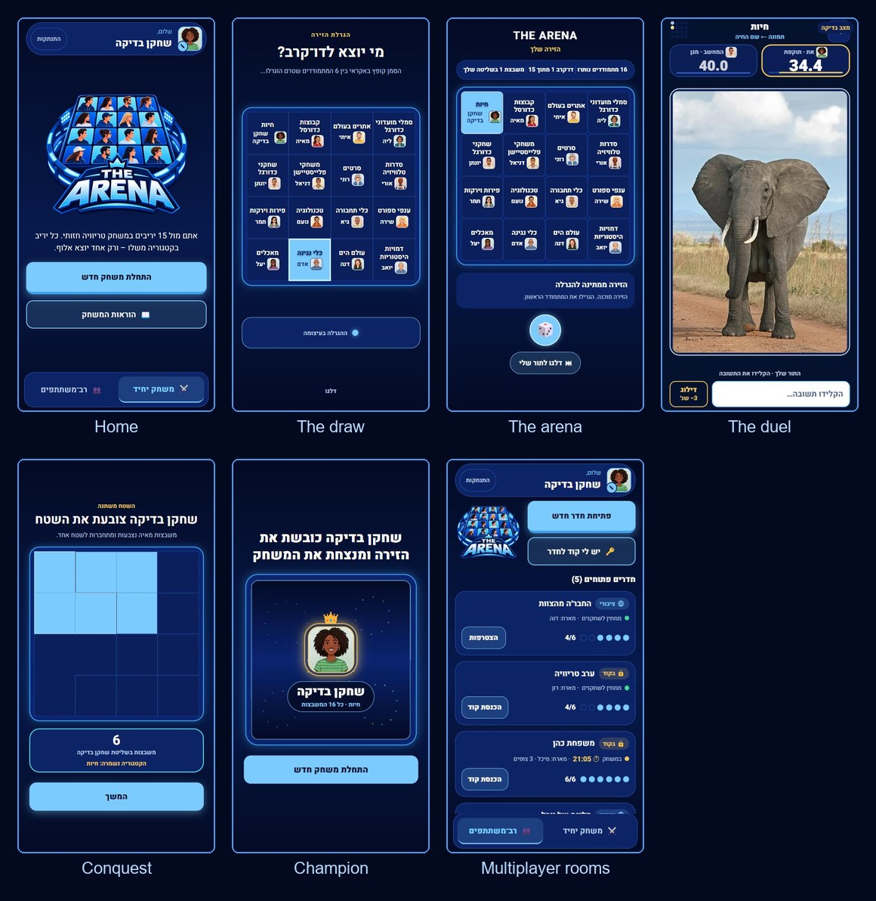
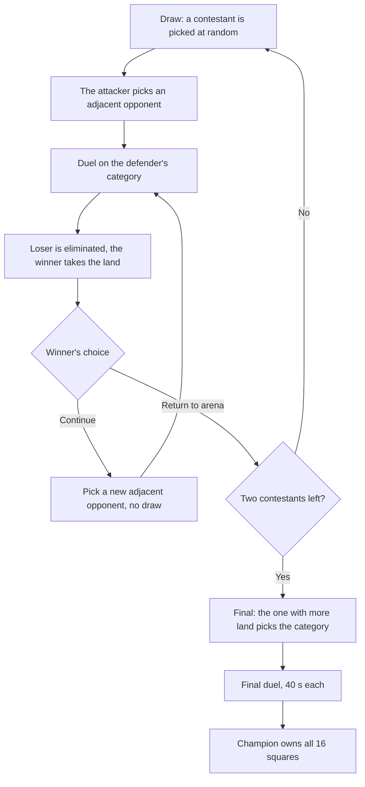
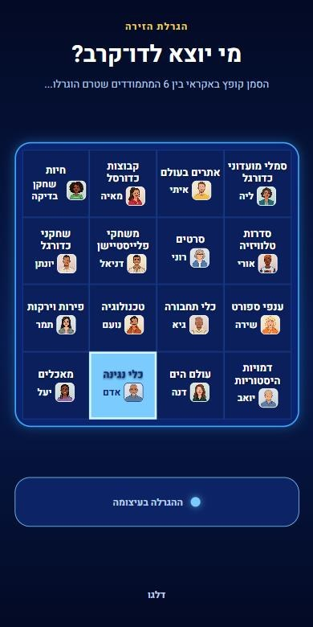
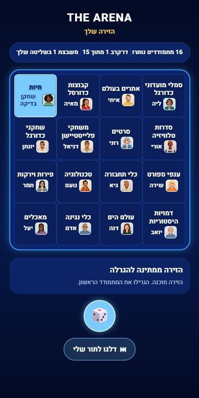
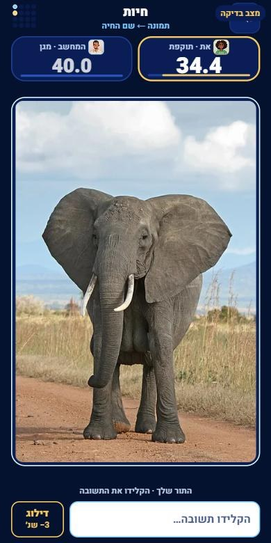
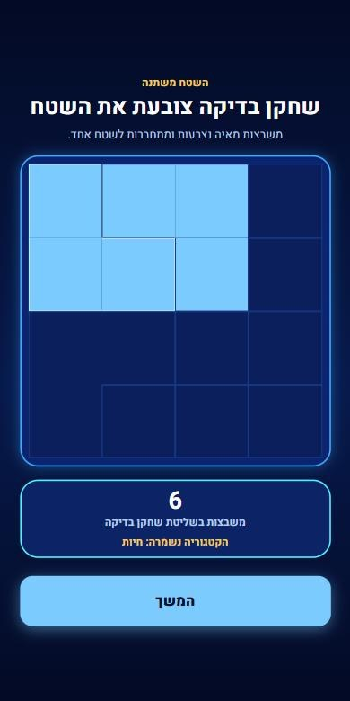
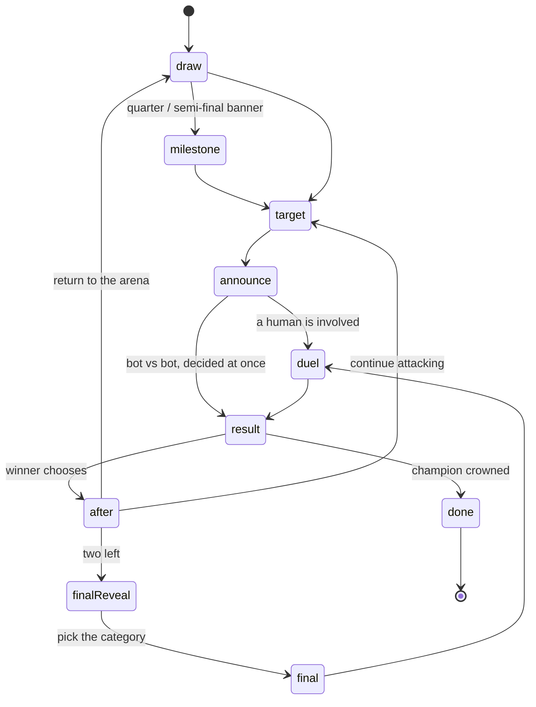
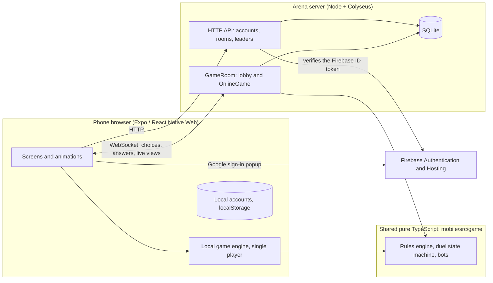
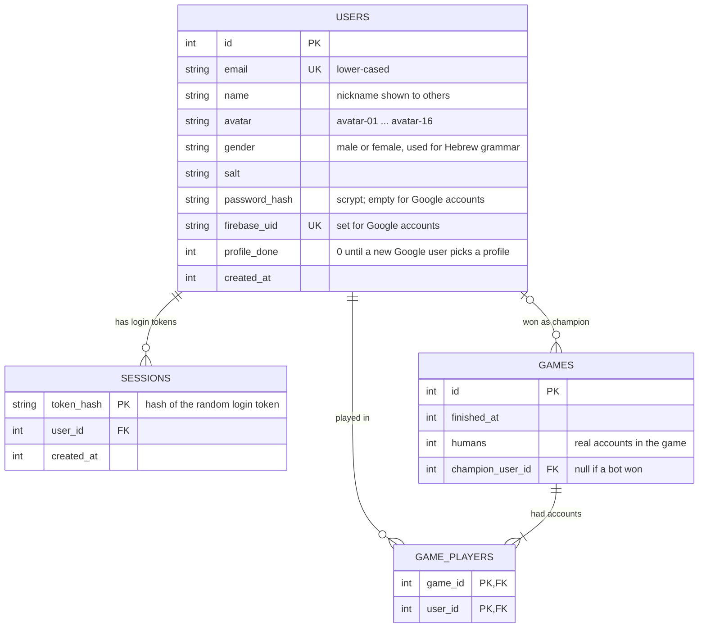
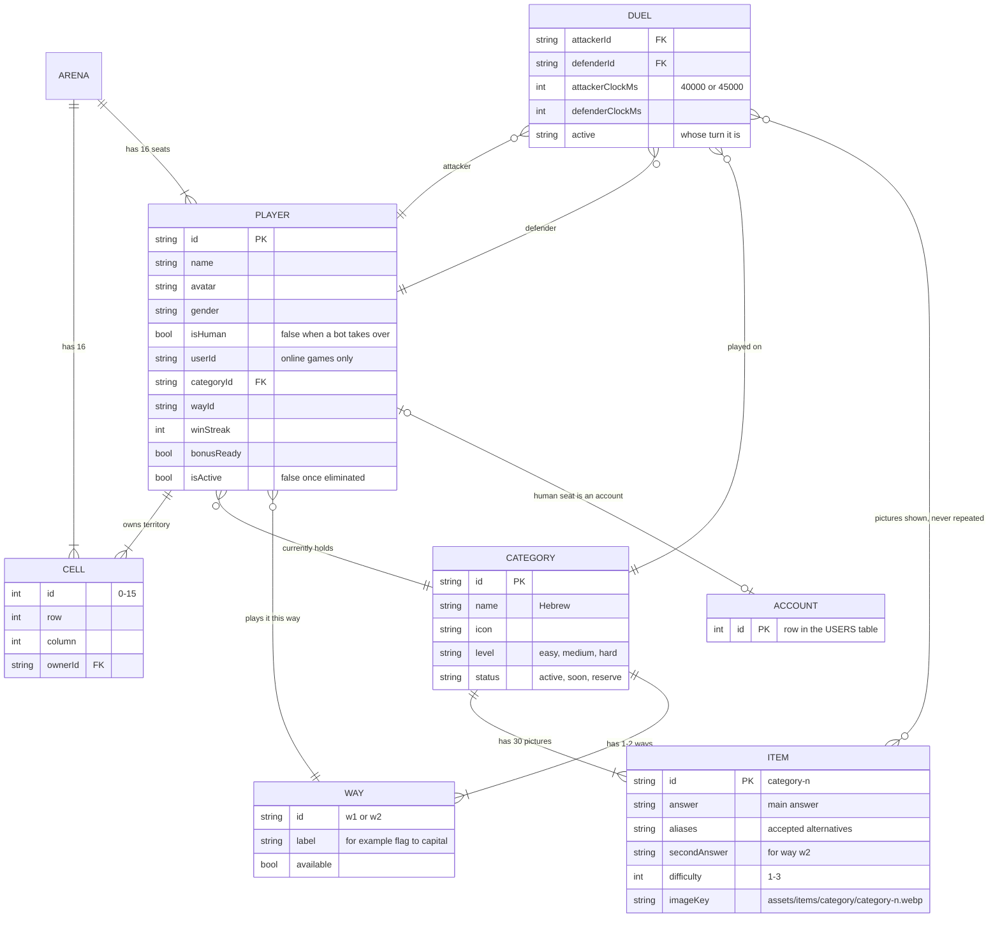

# THE ARENA (הזירה)

**A Hebrew visual-trivia battle game for the phone browser.** Sixteen contestants share a 4×4 arena. Each owns one square and one trivia category. Contestants attack their neighbours in timed picture-guessing duels, the loser is eliminated and the winner takes over the loser's land, until a single champion owns the whole board.

<p align="center">
  
</p>

<p align="center"><sub>The interface is Hebrew and right-to-left. Screenshots come from the app's built-in QA pages with sample data.</sub></p>

**Play it:** https://the-arena-game-v1.web.app (single player against 15 bots; the online mode needs the Arena server, see [status](#status-and-roadmap)) · also mirrored at https://yakirc0412.github.io/The-Arena-Mobile-Game/

---

## Contents

1. [The game and its rules](#1-the-game-and-its-rules)
2. [Game modes](#2-game-modes)
3. [Architecture and tech stack](#3-architecture-and-tech-stack)
4. [Data model (ERD)](#4-data-model-erd)
5. [Repository structure](#5-repository-structure)
6. [Getting started](#6-getting-started)
7. [The admin panel](#7-the-admin-panel)
8. [Testing](#8-testing)
9. [Documentation index](#9-documentation-index)
10. [Status and roadmap](#status-and-roadmap)

---

## 1. The game and its rules

The full rulebook (in Hebrew, the source of truth for the code) is [`docs/GAME_RULES.md`](docs/GAME_RULES.md). This is the short English version.

### At a glance

| | |
|---|---|
| Board | 4×4 grid, 16 squares, 16 contestants (you plus 15 bots, or several real players plus bots) |
| Content | 35 playable categories with 30 picture items each (1,050 pictures), 7 categories with two ways to play |
| Duel | Each side has a **40 s** clock (**45 s** with a bonus) that runs only on their turn |
| Answering | Type the answer in Hebrew. It is checked automatically while you type, there is no submit button |
| Correct answer | The turn passes to the opponent after a short pause (0.7–1.0 s), no time lost |
| Skip | **−3 s** and a new picture; the turn stays with you |
| Losing | Your clock reaches zero: you are eliminated and your land goes to the winner |
| Game length | Always **15 duels**, then one champion |

### How a game flows



<p align="center">
  
  
  
  
</p>
<p align="center"><sub>The draw · the arena · the duel · the conquest</sub></p>

### The arena and the draw

- Squares touch only up, down, left and right (no diagonals). A contestant with several squares owns **one territory** and can attack from any square on its border.
- Contestants are drawn in rounds. Only the contestant drawn as **attacker** is marked for the round, so a defender who took part in a duel can still be drawn later. When everyone has been drawn, the round resets.
- A winner who chooses to continue attacking is not drawn again.

### The duel

- The picture comes from the **defender's category** and the way it is played (see below). The attacker starts.
- A picture never repeats within a duel. Pictures come in random order but get harder as the duel goes on: each category has 12 easy, 10 medium and 8 hard pictures, the first picture is always easy, and a hard one cannot appear before the 4th.
- Whoever's clock hits zero first loses.

### After a duel

- The loser is eliminated and **all of their land goes to the winner**.
- **Attacker wins:** keeps their own category; the defender's category leaves the game.
- **Defender wins:** inherits the attacker's category (with its way); the defender's previous category leaves the game.
- Every winner, including a defender who won, chooses: **continue** (attack another neighbour immediately) or **return to the arena** (a new contestant is drawn). If the winner has no neighbour left they return automatically.

### Win streak and bonus

- Three wins in a row, without returning to the arena in between, earn a **bonus: 45 s instead of 40 s** in the next duel.
- A defender's win counts as win number 1 in the streak. Returning to the arena before the third win resets the streak to 0.
- A bonus that was earned is kept until it is used, and is applied automatically in the next duel in any role. Only one bonus can be held.
- When two contestants remain (the final), all streaks and bonuses are cleared; neither the duel leading to the final nor the final itself can earn a bonus.

### Categories and ways

- 35 playable categories (animals, countries, sports, movies, football clubs, brands, Israeli history sites and more) plus 4 hidden "reserve" categories used as filler. See [`docs/CATEGORIES.md`](docs/CATEGORIES.md).
- A **way** is how a category is played: what the picture shows and what you type. Some categories have two, for example countries as *flag → country name* or *flag → capital city*.
- When a game is built, the player picks one category (and a way). The other 15 are drawn: up to 3 hard, 6 medium and 6 easy, topped up from other available categories.

### The final

When two contestants remain, the one holding more squares chooses the category from the two they hold (a tie goes to the last winner). The final is played with 40 s each, and the winner is the champion.

### Bots

Bots choose targets by territory size, the risk of revenge and a random factor. In a live duel a bot answers after a thinking delay that grows with the answer's length (about 0.24 s per letter, a pause between words) and with the picture's difficulty, and its accuracy drops on harder pictures (77% / 62% / 47%). A duel between two bots is decided in the background with the same rules.

### Skip to my turn (single player)

When no draw is running you can press **Skip to my turn** to let the bots play on in the background until you are involved again: you are drawn, a bot attacks you, or the final is reached. You cannot be eliminated while skipping.

---

## 2. Game modes

### Single player

You against 15 bots, entirely in the browser (no server needed). Accounts are local to the device (email and password, or Google sign-in). This is what the public site runs.

### Multiplayer (rooms)

Real people play each other live, with bots filling the empty seats. The server is **authoritative**: it owns the clocks, checks every answer and decides every result, and answers are never sent to the phones.

- **Rooms:** up to **6 humans** per room; the remaining seats (up to 16) are bots. A room is **public** (listed live with seats, status and timer) or **private** (joined with a code). Games in progress can be **watched**.
- **Lobby:** every player must pick a category (and a way) before starting; each category can have only one owner, and you can switch freely until the host starts. The host starts the game once at least 2 humans are in and everyone has a category, or closes the room.
- **In game:** humans choose their target within 20 s (otherwise the bot's choice is used). If a human is away for 30 s a bot takes their seat, and they get it back between duels. Everyone else watches the live duel.
- **Hall of fame:** a full game won with 2 or more real accounts counts as a win on the leaderboard.



---

## 3. Architecture and tech stack



| Layer | Technology |
|---|---|
| App | Expo SDK 58, React Native 0.88 + React Native Web, React 19, expo-router, TypeScript |
| Game logic | Pure TypeScript in `mobile/src/game` (no React), shared by the app **and** the server |
| Server | Node 24, TypeScript, Colyseus 0.18 (rooms over WebSocket), SQLite through `node:sqlite` |
| Auth | Local accounts (salted SHA-256 on the device) and Google sign-in through Firebase Authentication. The server verifies Firebase ID tokens itself (RS256 against Google's certificates), without `firebase-admin` |
| Hosting | Firebase Hosting (live site) and GitHub Pages (mirror, built by [`pages.yml`](.github/workflows/pages.yml)) |
| Tests | A tiny dependency-free runner (`mobile/tests/harness.ts`): 98 app tests, 27 server tests |

Design principles: the rules live in one place and are tested; every screen change goes through a pure `flowReducer`; the server runs the same engine as the single-player game, so the two cannot drift apart.

---

## 4. Data model (ERD)

### 4.1 Server database (SQLite, `server/data/arena.sqlite`)

Accounts, login sessions and the leaderboard. Defined in [`server/src/db.ts`](server/src/db.ts).



A finished game is recorded only if 2 or more accounts took part, so nobody can farm wins against bots.

### 4.2 Content and game model

The content lives in one JSON file edited by the [admin panel](#7-the-admin-panel); a game is built in memory from it ([`mobile/src/game/types.ts`](mobile/src/game/types.ts)).



---

## 5. Repository structure

```
THE_Arena/
├─ README.md                  this file
├─ CLAUDE.md                  context for AI coding assistants (run commands, rules, status)
├─ PRODUCT.md · DESIGN.md     product brief and design system ("night stadium": navy, sky blue, Heebo font)
├─ firebase.json · .firebaserc   Firebase Hosting config (serves mobile/dist-web)
│
├─ mobile/                    the game app (Expo / React Native Web)
│  ├─ src/
│  │  ├─ app/                 routes only (expo-router); (dev)/ holds the QA pages used for screenshots
│  │  ├─ game/                pure game logic: engine, duel state machine, flow reducer, lobby rules, types
│  │  ├─ content/             categories data (categories-data.json), avatars, picture manifest
│  │  ├─ features/            screens, one folder per part of the game
│  │  │  ├─ onboarding/       intro, sign-up / sign-in (email and Google), guide
│  │  │  ├─ home/             home with Single / Multi tabs, room cards, podium, profile editor
│  │  │  ├─ lobby/            multiplayer lobby and category picker
│  │  │  ├─ flow/             game flow container, setup, result
│  │  │  ├─ arena/            arena board, build and draw animations, HUD screen
│  │  │  ├─ battle/           the duel, clocks, AI, conquest animation
│  │  │  ├─ online-game/      the online game screens
│  │  │  └─ final/            final reveal, final category, champion celebration
│  │  ├─ design/              design tokens, brand components, generic UI (bottom sheet, picture frame)
│  │  ├─ hooks/               sound and haptics, keyboard handling on iPhone, reduced motion
│  │  ├─ online/              network layer: rooms, server session, Firebase sign-in
│  │  ├─ services/accounts/   local accounts
│  │  └─ vendor/              the Colyseus browser SDK (vendored)
│  ├─ assets/                 avatars, ~1,050 item pictures (WebP), sounds, app icons
│  ├─ scripts/                build helpers: item-image manifest, image credits, feedback sounds
│  ├─ tests/                  engine, rules, duel, flow, accounts, multiplayer and 1,000 seeded random games
│  └─ public/                 web page template and PWA manifest
│
├─ server/                    multiplayer server (Node + Colyseus + SQLite)
│  ├─ src/                    GameRoom, OnlineGame, lobby rules, HTTP API, auth, Firebase token check, database
│  └─ tests/                  unit tests and live smoke-test scripts
│
├─ admin/                     admin panel for categories, items and pictures (see section 7)
├─ docs/                      rules, decisions, roadmap, multiplayer spec, status log; archive/ = old documents
├─ .claude/                   preview-server configs and the picture-collection skill
├─ .github/workflows/         GitHub Pages build
└─ archive/                   local only, not in git
```

---

## 6. Getting started

**Prerequisites:** Node.js 24 (the server uses the built-in `node:sqlite`), a recent npm, and optionally [pnpm](https://pnpm.io) for the app (the lockfile is `mobile/pnpm-lock.yaml`). On Windows use `npx.cmd` / `npm.cmd` if PowerShell blocks scripts.

### Run the game (single player)

```bash
cd mobile
pnpm install          # or: npm install
npx expo start --web --port 8090
```

Open http://localhost:8090. On a phone, open the same address on your local network (for Google sign-in a phone needs HTTPS or `localhost`).

### Run the multiplayer server

```bash
cd server
npm install
npm run start         # builds with tsc, listens on port 2567
```

The app finds the server at `http://<same host as the page>:2567` (override with `EXPO_PUBLIC_ARENA_SERVER`). A simple test page lists rooms at http://localhost:2567/rooms.

### Optional: Google sign-in

Create a Firebase project, enable the Google provider, and put its public web config in two git-ignored files. Steps in [`docs/GOOGLE_LOGIN_SETUP.md`](docs/GOOGLE_LOGIN_SETUP.md).

| File | Variables |
|---|---|
| `mobile/.env` | `EXPO_PUBLIC_FIREBASE_API_KEY`, `EXPO_PUBLIC_FIREBASE_AUTH_DOMAIN`, `EXPO_PUBLIC_FIREBASE_PROJECT_ID`, `EXPO_PUBLIC_FIREBASE_APP_ID` |
| `server/.env` | `FIREBASE_PROJECT_ID` (optional: `PORT`, `ARENA_DB`) |

Without them the Google button stays disabled and everything else works.

### Build and deploy the website

```bash
cd mobile && npx expo export -p web --output-dir dist-web
cd .. && npx firebase-tools deploy --only hosting
```

Pushing to `main` also builds the GitHub Pages mirror automatically.

---

## 7. The admin panel

[`admin/`](admin/) is a local tool for editing the game's content: categories, items, accepted answers, ways and pictures. It reads and writes the real files in `mobile/` and moves anything it removes to `archive/` instead of deleting it.

```bash
cd mobile && npm run admin       # or: node admin/server.js
```

Open http://localhost:8095. Details in [`admin/README.md`](admin/README.md); `node admin/smoke-test.js` runs an end-to-end check while the panel is running.

---

## 8. Testing

```bash
cd mobile && npx tsc --noEmit && npm test      # type check, then 98 tests
cd server && npm test                          # 27 tests
node tests/live-game-check.mjs                 # from server/, with the server running: two scripted phones play a whole game
```

The tests cover every rule scenario in the rulebook, the duel state machine with a fake clock, the multiplayer lobby and online game, accounts, and **1,000 seeded random full games** that must each end with exactly 15 duels and one champion.

---

## 9. Documentation index

| Document | What it is |
|---|---|
| [`docs/GAME_RULES.md`](docs/GAME_RULES.md) | The rulebook (Hebrew), source of truth for the engine |
| [`docs/DECISIONS.md`](docs/DECISIONS.md) | Product and technical decisions, with dates |
| [`docs/ROADMAP.md`](docs/ROADMAP.md) | Phases and what is next |
| [`docs/PRD_MULTIPLAYER.md`](docs/PRD_MULTIPLAYER.md) | The multiplayer specification |
| [`docs/CATEGORIES.md`](docs/CATEGORIES.md) | Category list and levels |
| [`docs/GOOGLE_LOGIN_SETUP.md`](docs/GOOGLE_LOGIN_SETUP.md) | Enabling Google sign-in |
| [`docs/STATUS_LOG.md`](docs/STATUS_LOG.md) | Dated log of every work step |
| [`docs/IMAGE_CREDITS.md`](docs/IMAGE_CREDITS.md) | Source and licence of each picture (generated) |
| [`PRODUCT.md`](PRODUCT.md) · [`DESIGN.md`](DESIGN.md) | Product brief and design system |

---

## Status and roadmap

**Done:** the complete single-player game; the full online game (rooms, lobby, live duels, bots, reconnect, leaderboard) on a local server; accounts and Google sign-in; admin panel; web hosting.

**Not yet:**
- The multiplayer server is not hosted publicly, so the live site is single player only. Next step is cloud hosting (HTTPS/WSS), rate limits and room limits.
- Moving single player to the server so the answer file leaves the web bundle.
- Licensing review before any public launch: pictures are credited in `docs/IMAGE_CREDITS.md`, but some (logos, posters, characters) are not freely licensed. No licence file has been added to the repository yet.
- Password reset (needs an email service) and bot skill levels.

The project is built as a personal learning project with AI pair-programming; [`CLAUDE.md`](CLAUDE.md) is the working context used for that.
